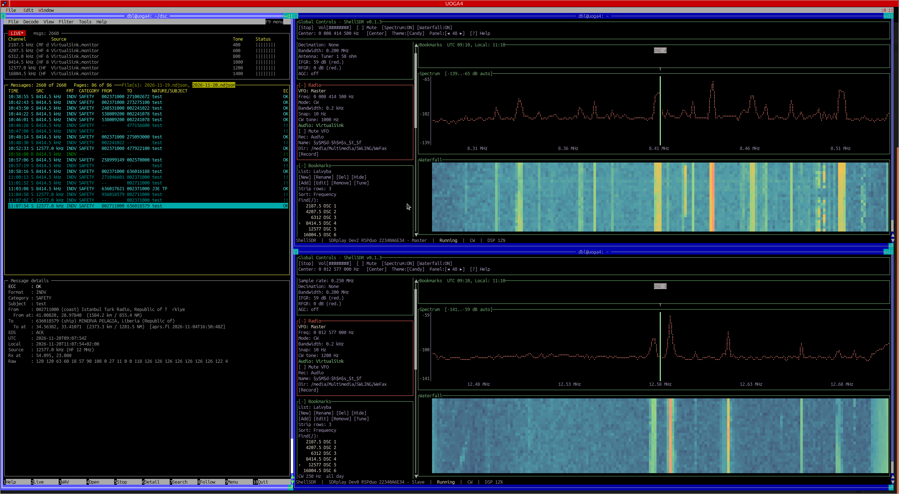
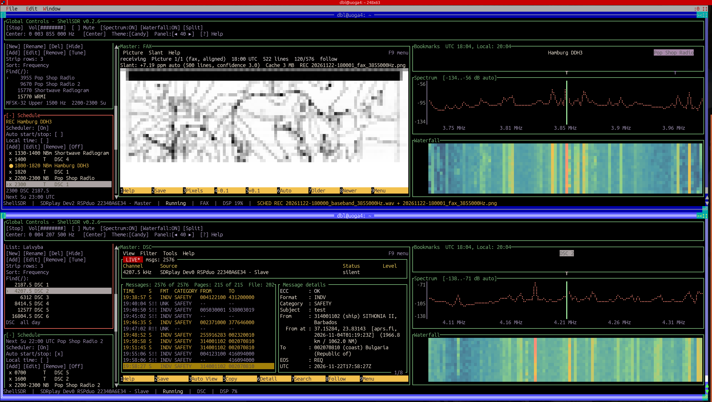
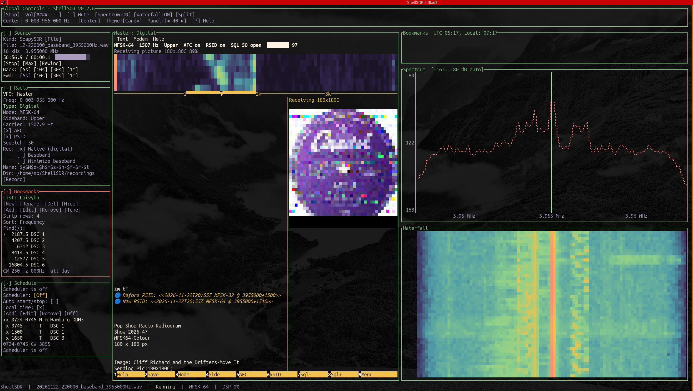
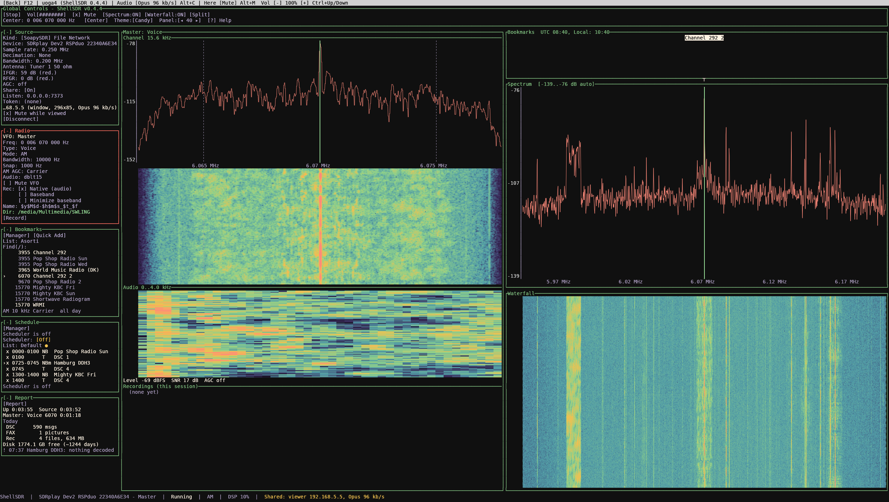
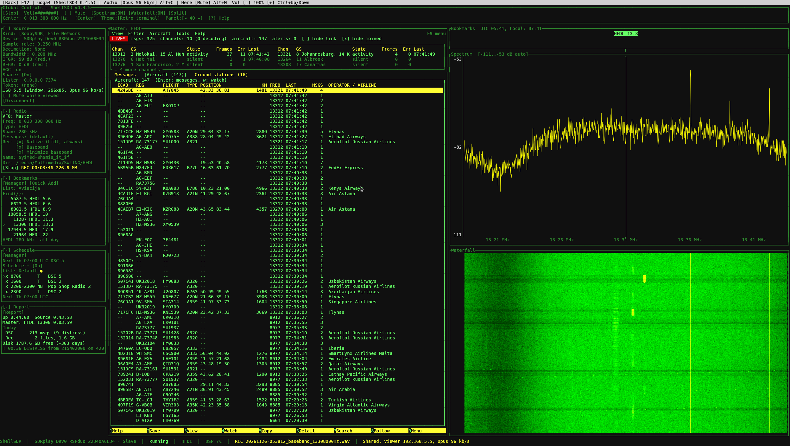
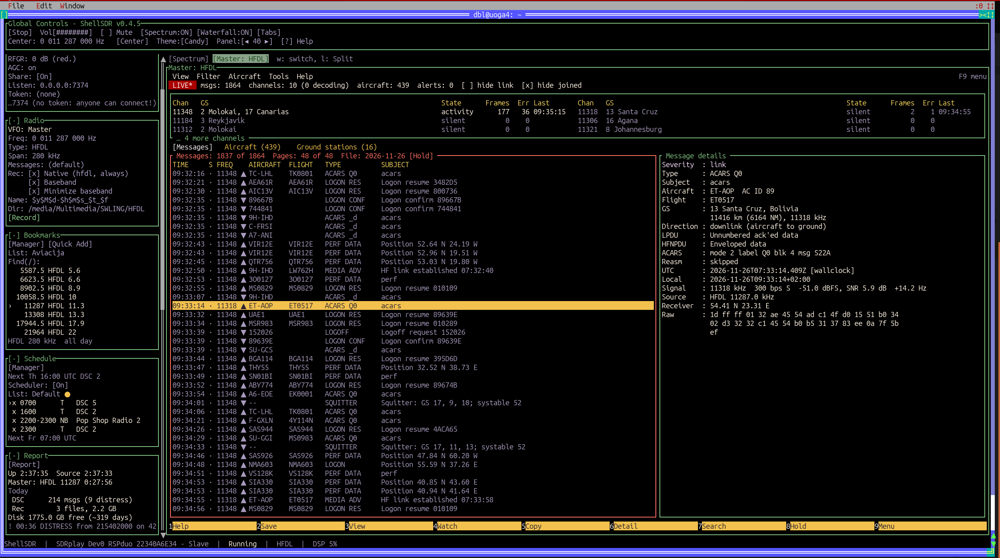

# ShellSDR

A terminal (TUI) software-defined-radio receiver and recorder for Linux, optimized to run on an old **Raspberry Pi 3** (1 GB RAM). It talks to SDR hardware through **SoapySDR** (primary target: an **SDRplay RSPduo**), demodulates audio (**NFM/WFM/AM/DSB/USB/LSB/CW**), decodes maritime **DSC**, aircraft **HFDL** (ACARS, CPDLC, ADS-C), **weather fax** and **MFSK** text with pictures (RSID), shows a power spectrum and waterfall, keeps bookmarks, records audio and baseband to WAV (also on a schedule), and plays back **SDR++/ShellSDR** baseband WAV files (baseband files have metadata saved in the RIFF Comment section). The UI is keyboard-first: every action has a visible control. Multiple simultaneous VFOs are planned (see `SPECIFICATION.md`).


**ShellSDR** (0.1.x) running happily on **RSPDuo** with a [DSC Decoder](https://github.com/darauble/DSC-Decoder-Seed) on a **Raspberry Pi 3** in a [Twin Terminal Multiplexer](https://github.com/cosmos72/twin):



**Weather fax and DSC** (0.2.6): two ShellSDR instances on the two RSPduo tuners, one receiving Hamburg DDH3 on 3855 kHz from the schedule (FAX view with auto slant, recording the picture and the baseband), the other decoding DSC on 4207.5 kHz with the message list and details:



**Digital** (0.2.6): a recorded Pop Shop Radio Radiogram on 3955 kHz played back from a baseband file, MFSK-64 after an RSID switch, receiving a 180x180 colour picture beside the text:



**Network Mode with Full Control** (0.4.4): a ShellSDR can now control remotely running instance and has a eGUI. eGUI has the same look and feel of TUI, but it can display granular waterfall and actual decoded pictures, not just blocky ASCII art. Remote ShellSDR can work as a headless server or it can be running in a detached terminal with its full UI and perform unattended monitoring and recording – a unique feature. In this mode local client ShellSDR actually works as a Remote Desktop equivalent (a second display) for the remotely running instance. A special row on the top of window show possible local controls, because „Mute“ in the normal window mutes the server, not the client 😄️



**HFDL Decoder** (0.4.5): ShellSDR integrates directly the HFDL-ACARS decoder for those interested in aviation messages over HF – and it looks great in retro-terminal theme!



Another view of decoded messages with details (similar to DSC):



HFDL Decoder specification and seed can be found [here](https://github.com/darauble/HFDL-ACARS-Decoder-Seed).

## What is new in 0.4.8
- **Pictures as pictures in the window:** in the window (`--gui`), FAX pictures, MFSK pictures and the MFSK waterfall are now painted at pixel resolution, like the spectrum and the waterfall, instead of the terminal's half blocks. This works in a window into a sharing ShellSDR too (the pictures travel compressed, at most twice a second), when both ShellSDRs are 0.4.8 or newer.

## What is new in 0.4.7
- **HFDL in the Report:** HFDL messages are counted live and from files, by severity, by station and by hour, with the frames that failed their check. Two new measures: **planes seen** (distinct aircraft heard) and **stations received** (distinct ground stations heard), for the day, the month and the lifetime, kept in `<profile>_seen_YYYY-MM.json` next to the other report files (live reception only). HFDL alerts go to the log (category `HFDL`): emergency and caution as warnings, watched aircraft as info; the hook gets emergency and caution alerts (`on HFDL alerts` in Settings, on by default). The panel, Today, Month, Lifetime and the midnight report show them.

## What is new in 0.4.6
- **HFDL sensitivity:** each channel is demodulated twice with different settings and the copy of a frame that checks is kept. On five real recordings this decodes about 6% more frames than one demodulator (1058 against 999; dumphfdl 1040 on the same recordings), at about twice the receiver's CPU.

## What is new in 0.4.5
- **HFDL in a VFO:** a new VFO type, `HFDL`, decodes every HFDL channel of a band at once (aeronautical HF data link: ACARS, CPDLC, ADS-C, MIAM and the link messages), live or from a baseband recording. Put the VFO on a band center and set its `Span` (280 kHz by default, enough for the widest band); the channels inside it are found from the ground-station table. `F9` > Tools > `Add HFDL band bookmarks` adds a bookmark list `HFDL` with the 13 band centers.
- **The HFDL view** (Work Area, as the DSC view): the channels with their state (silent, activity, decoding), frames, errors and last frame; three tabs: **Messages** (time, severity, frequency, aircraft, flight, type, subject; details beside or below), **Aircraft** (ICAO address, registration, flight, type, last position and its distance, last frequency, messages; watched aircraft marked) and **Ground stations** (the system table with what was heard). Keys `F1` to `F9` as in the DSC view: save, views, watch, copy, details, search, follow, menu.
- **Alerts:** emergency and caution content (keywords you can edit, CPDLC MAYDAY / PAN PAN, ADS-C emergency reports) and watched aircraft give a banner, the status bar mark, a bell and an optional desktop notification. Link traffic and the blocks of an ACARS message joined later are stored but hidden by default (`n`, `j`).
- **Day files:** every message is stored, one NDJSON line per message (`YYYY-MM-DD.ndjson` in the VFO's `Messages` folder, the recordings folder by default), with what was known at reception; another ShellSDR writing the same folder shows up live.
- **Your location** is now one setting for the whole program (`[location]` in the profile), used by DSC and HFDL for distances; a DSC location from an older profile is taken over once.
- **Enrichment (optional):** name an aircraft file (OpenSky `aircraftDatabase.csv`), an airlines file (OpenFlights with a header) and an airports file (OurAirports `airports.csv`) in the Aircraft menu, and messages show the aircraft's type, operator, airline and route airports with distances. **Online lookups** at hexdb.io and adsbdb.com can be switched on separately (both off by default): aircraft and routes are asked at most once a second per service and cached (`lookup-cache.ndjson`) for display only.
- A recording's center frequency is also read from names with `kHz` or `MHz` (`8902.5kHz`, `8.9025MHz`).

## What is new in 0.4.4
- **An application icon:** the window (`--gui`) shows the ShellSDR icon (`assets/icon/shell-sdr-icon.svg`, compiled in). Both packages install it (`share/icons/hicolor/scalable/apps/shellsdr.svg`) with menu entries in `share/applications/`: `ShellSDR` (the window, in a build with the GUI) and `ShellSDR (terminal)` (every build), so the desktop's menu and dock show the icon for either.

## What is new in 0.4.3
- **Compression you can see and change:** the Network source's `Audio` row is now `Compression` (Opus 16 to 96 kb/s, or Off: PCM). What a connection actually uses is shown on both ends: in a window's bar (`Audio [Opus 32 kb/s]`), in the status bar of a running headless stream (`Network: Opus 32 kb/s`), and on the sharing ShellSDR in the viewer line and its status bar (`Shared: viewer 10.0.0.2, Opus 32 kb/s`), so a window shows it on the shared screen too. When Opus was asked for but cannot be had, it says why: `PCM 768 kb/s (no libopus on the server)` or `(no libopus here)`.
- **Changed while connected:** a click on the window bar's `[Opus 32 kb/s]` (or `Alt+C`) steps the compression, a right click steps back; on a running headless stream the `Compression` row does the same. The audio switches without reconnecting, with a 0.4.3 server; an older server reconnects (a stream) or says it changes only on a new connection (a window).
- **A window's own bar:** a window into a sharing ShellSDR keeps one line at the top for what stays on this side: `[Back]` (also `F12`, or `Ctrl+]` where the keyboard has `]`), the compression, and the audio heard here: `[Mute]` (`Alt+M`) and the volume `[-]` / `[+]` (`Ctrl+Up` / `Ctrl+Down`). Every other key and click goes to the shared screen, whose own Mute and volume are the server's speakers.
- **Start opens the window:** on a Network source pointing at a sharing ShellSDR, Space or `[Start]` opens its window (there is no stream to start), as `[Open window]` does.
- Fixed: `Ctrl+]` did not leave a window in `--gui`.

## What is new in 0.4.2
- **ShellSDR in a window:** `shellsdr --gui` is the same ShellSDR as in a terminal (the profile, the radio, every module, sharing, the Network source), drawn in a graphical window: the same screen and keys, with the **spectrum and the waterfall at the window's pixel resolution, and the Voice view's channel spectrum, channel waterfall and audio waterfall too** (with the filter edges). The window's own keys: `Ctrl+=` / `Ctrl+-` the text size, `Ctrl+0` back to normal; closing the window is quitting (it asks first while running, as `q` does). Its size and text size are kept in `~/.config/ShellSDR/gui.toml`.
- A window into a sharing ShellSDR opened from it (Network source, `[Open window]`) gets the same pixel plots.
- While a popup or dialog is open over the plots they are drawn as cells (the dialog stays readable).
- In both packages; without a desktop `--gui` says what is missing and exits (the terminal version needs none of it).
- Fixed: a Network source that asked a headless server and then pressed Start at once could be refused as busy.

## What is new in 0.4.1
- **A window into a running ShellSDR:** a ShellSDR with its TUI (e.g. on the Pi in tmux) can be shared, and another ShellSDR shows its screen and works it like a remote desktop, with its audio. Everything keeps running where the radio is: the source, the decoders, recordings, the schedule, the Report; the window is only a window. One focus for both sides: a key or a click from either acts on the same screen, each side laid out for its own size.
- **Sharing:** at the end of the Source module (every kind): `Share: [On]`, `Listen` (`127.0.0.1:7373`, only this machine; `0.0.0.0:7373` for the network), `Token` (the secret a viewer must give), the status (`waiting`, or the viewer and its size), and while a viewer is connected `[ ] Mute while viewed` (the audio here, the viewer hears it either way) and `[Disconnect]`. Saved in the profile: a profile with Share on shares from the start. The status bar shows `Shared: viewer <ip>`, the Report logs viewers coming, leaving and refused. A viewer cannot quit the program.
- **Viewing in a terminal:** the Network source (0.4.0) tells a sharing ShellSDR from a headless server: enter its address and token, and `[Open window]` shows its screen in this terminal. `Ctrl+]` comes back (this ShellSDR kept running underneath), `Ctrl+Up` / `Ctrl+Down` set the window's volume (0.4.3: a bar with `[Back]`, `F12`, the compression, the local Mute and volume).
- **Viewing in a graphical window:** see 0.4.2 (`shellsdr --gui` became the whole ShellSDR in a window). The window loads its display libraries only when it opens, so the package runs on a Pi without a desktop too; there `--gui` says what is missing (no `DISPLAY` / `WAYLAND_DISPLAY`, or the X11 / Wayland / OpenGL libraries: `libx11-6`, `libxkbcommon-x11-0` or `libwayland-client0`, `libegl1`, all on a desktop system already) and exits.
- One viewer at a time; the traffic is not encrypted (an SSH tunnel for the internet, as for the Network source).

## What is new in 0.4.0
- **Network source:** a ShellSDR can listen through another one. On the machine with the radio run `shellsdr --serve` (headless, no TUI); on the other choose **Kind: Network** in the Source module, enter the server's address and token, pick its device and press Start. The server runs the SDR and the DSP; the client gets the spectrum (1024 bins, the peak of each group kept), the VFO view, the decoders' input and the audio, compressed with **Opus** (16 to 96 kb/s, or uncompressed PCM), and sends tuning, mode, gains and the other settings back. Decoding (DSC, FAX, Digital), recording, bookmarks, the schedule and the Report work on the client as with a local radio. A native (audio) recording is made from the audio received; a baseband recording needs the radio's machine.
- **The server:** `shellsdr --serve` listens on `127.0.0.1:7373` (only this machine); `--serve 0.0.0.0` (or an address, `host:port`) for the network, with `--token SECRET` so that only who knows it can use the radio. One client at a time; the SoapySDR devices are offered, and `--serve-file WAV` (repeatable) also offers a baseband recording, played in a loop, for testing without a radio. `Ctrl+C` stops it and releases the device. The traffic is not encrypted: over the internet use an SSH tunnel (`ssh -L 7373:localhost:7373 pi4`, client server `localhost`).
- **Opus** is the system's **libopus** (`libopus0`, installed on most systems), loaded at run time; without it both ends fall back to PCM (about 0.8 Mb/s).
- **Upgrading:** a profile saved with the Network source selected needs 0.4.0 (an older ShellSDR opens it read only).

## What is new in 0.3.0
- **Module pages in the Work Area:** Bookmarks, Schedule and the new Report have a page that takes the Work Area (the VFO's tab, or its half in Split) when you open it with the module's button (`[Manager]`, `[Report]`) or `o`. `Esc` in the page gives the Work Area back to the VFO. Focusing a module never switches the Work Area.
- **Bookmarks:** the panel keeps the list, Find, the bookmarks and **[Quick Add]** (the active VFO into the list, no editor). The **Manager page** has the lists (with their strip visibility and buttons), a table with every column, the selected bookmark in full (with the jobs that use it), and function keys: F2 Add, F3 Edit (the editor is drawn in the page), F4 Copy and F5 Move to another list, F6 Tune, F7 Find, F8 Delete.
- **Schedule lists:** jobs live in named lists and **only the active list runs**, so you can plan e.g. a day of faxes and go back to DSC tracking with one `[Activate]`. Existing jobs become the list "Default". The **Manager page** has the switches, the lists, the job table with every column, a day **timeline**, the selected job's **last runs** (from the Report), and F2 Add, F3 Edit, F4 Copy, F5 On/Off, F6 Move, F8 Delete.
- **Switching the Scheduler on (or activating a list) brings back the current job:** a recording whose window is open starts again (also one you stopped), else the Tune only job that fired last is applied again, so casual listening with the scheduler off does not lose your place.
- **Report:** a new module for mostly unattended operation. The panel shows the uptime, the station the VFO is on and for how long, what was decoded today, free disk space and the newest problem. The page has **Today** (running times, work done live and from files, stations with their noise floor, activity by hour, health, the day's pictures), **Month**, **Lifetime**, **Log** (every event, filtered) and **Settings**. Logged are starts, quits and crashes, the source, bookmarks tuned, scheduled jobs (also ones that decoded nothing), recordings, DSC distress and urgency calls, fax and Digital pictures, and health: disk low, CPU hot, Raspberry Pi throttling, DSP overload, dropped IQ, the clock not synchronised, a noise floor 6 dB off its week. A **watchdog** restarts a SoapySDR source that stops delivering samples.
- **Report files** go to a folder of your choice (Settings: a NAS works; changing it offers Move or Start fresh), named by the profile: `default_report.v1.json`, `default_log_YYYY-MM-DD.log`, and at midnight `default_report_YYYY-MM-DD.md`, the day as Markdown with its pictures. Days follow local time or UTC (a switch); retention is configurable.
- **Event hook:** a command run for chosen events (errors, warnings, DSC alerts, health), e.g. a phone notification with Simplepush: `curl -s --data-urlencode "key=XXXXXX" --data-urlencode "title=ShellSDR $2" --data-urlencode "msg=$3" https://api.simplepush.io/send` (`$1` level, `$2` category, `$3` text; also `SHELLSDR_*` environment variables). `[Test the hook]` in Settings tries it.
- **Upgrading:** the schedule moves to `<profile>.schedule.v3.json` (the 0.2.x `.v2.json` is read once and kept, so a 0.2.x build still works with it).

## What is new in 0.2.7
- **Digital picture names follow the recording template:** a received picture is saved as `pictures/pic_` + the VFO's recording name at the picture's time (e.g. `pic_20261122-225707_digital_3955000Hz.png`), so two Digital recordings at the same time no longer write over each other's pictures. The `pictures/` subfolder is unchanged.

## What is new in 0.2.6
- **[Max] playback of a baseband file:** the File source has a **[Max]** button beside [Start]: the file plays as fast as the computer can decode it, for a recording you want decoded now (fax, DSC, Digital). The position line shows the speed reached (`▶▶45×`); **[1×]** returns to real time, Stop ends it. Nothing is played to the speakers at Max (recordings still get every sample), the spectrum and waterfall show every so many frames instead of scrolling faster, and the times of the decoded calls, marks and pictures are still the file's. A 30 min Shortwave Radiogram (minimized baseband) is decoded in about 40 s on a desktop PC; a 250 kHz baseband with a Voice VFO plays at about 8×.

## What is new in 0.2.5
- **Digital modes: MFSK with pictures and RSID** (e.g. Shortwave Radiogram, VOA Radiogram style broadcasts, amateur MFSK): set a VFO's `Type:` to **Digital** and tune it to the dial (the AM carrier of a broadcast, or the USB dial). Modes MFSK-4, 8, 11, 16, 22, 31, 32, 64, 128, 64L and 128L; `Carrier:` is the signal's audio offset (default 1500 Hz, or click the view's waterfall).
- **RSID** switches mode and carrier by itself, as in fldigi, and the text gets fldigi's marks as blue highlighted italic paragraphs (Obsidian): `==🔵*Before RSID: <<2026-11-18T18:51Z MFSK-32 @ 15770000+1496>>*==`, then `New RSID: ...`. An RSID of a mode ShellSDR does not decode yet (BPSK31, Olivia...) is only noted.
- **Pictures** (`Sending Pic:199x145C;`) are shown beside the text as they arrive; older ones with Left/Right.
- **Sideband:** `Upper`, `Lower` or `Both`. For an AM broadcast where one sideband is congested, take the other; `Both` locks onto the AM carrier and uses both sidebands as diversity (on a real Radiogram it found every RSID and picture, where one sideband missed some).
- **No garbage in the hiss:** a squelch on the decoder's quality (on by default, F7/F8 change it, 0 is off) keeps noise out of the text.
- **Saving:** the Digital recordings folder (`Dir:`) is the root. **[Record]** with Native writes a Markdown file that grows as the text arrives, pictures in its `pictures/` folder, linked in the paragraph after their `Sending Pic:` line. Without recording (or a `Tune only` job) everything is decoded and shown but nothing is written; **F2** saves the session so far the same way.
- It decodes straight from the IQ (no audio is made). The decoder is fldigi's, ported to Rust; ShellSDR is therefore under the **GPL v3 or later** from this version (see License).

## What is new in 0.2.4
- **One folder for everything a decoder writes:** F2 Save of a fax picture writes to the FAX recordings folder (`Dir:`); the separate `Pictures:` folder is gone.
- DSC writes its day files (`.ndjson`) to the DSC recordings folder when `Messages:` is empty, and Save offers the message folder. Messages from before stay in `~/.local/share/ShellSDR/dsc`: move them, or set `Messages:` to that folder.
- A `~` in `Dir:` now means the home folder for recordings too (it made a folder named `~`).
- The screen is no longer left half drawn after Start with an SDRplay device.

## What is new in 0.2.3
- **A recordings folder per VFO type:** the `Dir:` row of the VFO panel sets the folder of the VFO's type (Voice, DSC, FAX), so DSC baseband recordings and fax pictures can go to different folders. A type without its own folder uses the common one (`recordings_dir` in the profile, default `~/ShellSDR/recordings`).

## What is new in 0.2.2
- **Weather fax** (HF radiofax, e.g. DWD Hamburg 3855, 7880, 13882.5 kHz): set a VFO's `Type:` to **FAX** and tune it to the fax's published frequency (the receiver listens in USB 1.9 kHz below, so you hear the fax as usual). The Work Area view shows the picture as it comes in: with Unicode half blocks on any terminal, or as a real picture on terminals with the Kitty graphics protocol (Kitty, WezTerm, Ghostty; F3 switches).
- A new picture starts at each fax's START tone and is aligned on its phasing lines; a STOP tone ends it. Older pictures stay in memory (up to half of the computer's memory) and can be paged with F7/F8.
- **Straightening:** the slant (the sample clock error) is measured automatically every 100 lines; the status line says `Slant: measuring` until it is found, then the picture is redrawn straight. F4/F5 step the correction by hand (0.1 or 1 ppm), F6 switches Auto off and keeps the value.
- **F2 Save** writes the picture on screen to a PNG in the recordings folder (`Dir:` in the VFO panel) and frees the memory before it. **[Record]** with Native writes each fax to its own PNG in the recordings folder, line by line (the file opens at any time); a change of the correction rewrites it straight. The scheduler can record faxes too.
- Try it without a radio: `cargo run --release --example fax_baseband -- fax-audio.wav fax_3855000Hz.wav 3855000` makes a baseband file from a fax audio recording (USB, 1.9 kHz carrier) for the File source.
- The fax decoder is the [FAX library](https://github.com/darauble/radio_fax_decoder) (C++), loaded from `lib/shellsdr/libfax.so.1`. Without it the FAX type is shown as unavailable.

## What is new in 0.2.1
- **DSC decoder** (maritime Digital Selective Calling, ITU-R M.493): set a VFO's `Type:` to **DSC** and tune it to a DSC frequency (e.g. 2187.5, 8414.5 or 12577.0 kHz). It decodes straight from the IQ (no audio), and every call is written to `<folder>/YYYY-MM-DD.ndjson` (the `Messages:` folder in the VFO panel; empty = the DSC recordings folder, `Dir:`; until 0.2.2 `~/.local/share/ShellSDR/dsc`). Its Work Area view is the DSC decoder screen: the channel status, today's messages, the details (country, station names, positions and distances), alerts for distress (and urgency, if chosen), search, distress-only filter, follow/hold, save and copy.
- The DSC view is driven by **function keys** (F1 help, F2 save, F3 detail layout, F5 copy, F6 details, F7 search, F8 follow, F9 menu with your location, the aprs.fi ship lookup and the alert settings). ShellSDR itself uses no function keys.
- Two instances (both RSPduo tuners) can write to the same message folder; each view shows both. Only today's messages are shown; older day files stay in the folder.
- Scheduler: a DSC job's messages are always recorded; `Tune only` keeps DSC until another job or you change it, `Record` switches back when it ends (and can add the baseband).

## What is new in 0.2.0
- **VFO types**: a VFO has a `Type:` (only **Voice**, the audio demodulators, in 0.2.0; a **DSC** decoder is planned for 0.2.1). Every type keeps its own settings, so switching back and forth restores them.
- **Work Area**: the spectrum side now has a second view, the active VFO's own: for Voice a zoomed channel (fine click-to-tune for CW/SSB), an audio waterfall, level/SNR/AGC meters and this session's recordings. Show it as a tab (`w` switches) or side by side with the spectrum (`l`, or `[Tabs]`/`[Split]` in the Global bar).
- **Recording**: record the VFO's native output (audio), the baseband, or both at once. **Minimize baseband** keeps only the VFO's channel at the lowest rate it decodes from (e.g. 15.6 kHz for AM instead of 2 MHz); opening such a file puts the VFO back on it. Without `$t` in the name template, files end in `_n` (native) or `_b` (baseband).
- **Scheduler**: each job is `Tune only` or `Record` with Native and/or Baseband, and switches the VFO to its bookmark's type for the run.
- **Bookmarks** store the VFO type and its settings; the editor is built from the type. Bookmarks of a type your build does not have (borrowed from someone else's build) are kept and shown as `?Name`, but cannot be tuned.
- **Upgrading from 0.1.x** is automatic: the profile is backed up as `<profile>.toml.0.1.0.bak` and converted; bookmarks and schedules are converted into new files (`bookmarks.v2.json`, `<profile>.schedule.v2.json`), and the 0.1.x files are left untouched for an older ShellSDR. A file written by a newer ShellSDR is opened read-only (the status bar says so).

Documentation for developers: `HANDOVER.md` (start here), `SPECIFICATION.md` (feature spec and step checklist), `LESSONS.md` (decisions and lessons learned).

## Supported systems

| Package | Architecture | Oldest supported system |
|---|---|---|
| `shellsdr-<version>-x64.tar.gz` | x86_64 | Ubuntu 24.04 (also Debian 13 Trixie and newer) |
| `shellsdr-<version>-arm64.tar.gz` | aarch64 | Debian 13 Trixie / Raspberry Pi OS 13 64-bit (Pi 3, 4, 5, Zero 2 W) |

32-bit (armhf) systems are not built.

## Installing a release package
Install the runtime libraries (same names on **Ubuntu 24.04** and **Debian 13**) and the **SoapySDR** module for your device:

```sh
sudo apt install libsoapysdr0.8 libasound2t64
sudo apt install libopus0     # optional: Opus audio for the Network source (else PCM)
sudo apt install soapysdr0.8-module-rtlsdr
# e.g. for an RTL-SDR; SDRplay devices need
# SDRplay's API and the SoapySDRPlay3 module
```

Unpack the package into `/usr/local`:

```sh
sudo tar -C /usr/local -xzf shellsdr-0.4.0-arm64.tar.gz
```

This installs:

- `/usr/local/bin/shellsdr`, the program
- `/usr/local/share/shellsdr/themes/*.json`, the bundled color themes (**ShellSDR** finds them there; the **Default**, **Candy** and **Retro** themes are also built into the binary)
- `/usr/local/lib/shellsdr/`, the libraries of VFO types that need one (0.2.2: `libfax.so.1` for FAX). A type whose library is missing is shown as unavailable; **ShellSDR** itself always starts. Libraries are also looked for in `$SHELLSDR_LIB_DIR`, next to the program (`<bin>/../lib/shellsdr`) and in `/usr/lib/shellsdr`.
- `/usr/local/share/doc/shellsdr/`, the licence notice of `libfax.so.1` and the GPL v3 text.

To uninstall, remove those four paths.

## Running

```sh
shellsdr                              # default config ~/.config/ShellSDR/default.toml
shellsdr --config tuner2               # a second instance: ~/.config/ShellSDR/tuner2.toml
                                      #   (+ tuner2.schedule.v3.json)
shellsdr --config-path /path/to/x.toml   # a config file anywhere (schedule: x.schedule.v3.json beside it)
shellsdr --test                       # no hardware: a deterministic mock signal
shellsdr --serve                      # headless server for another ShellSDR's Network source (127.0.0.1:7373)
shellsdr --serve 0.0.0.0 --token SECRET   # the same, reachable from the network
shellsdr --serve --serve-file rec.wav  # also offer a baseband recording (looped) as an input
shellsdr --gui                        # the same ShellSDR in a graphical window (pixel spectrum and waterfalls)
```

Settings are saved to the config file on exit, per VFO and per VFO type. **Bookmarks are shared by all instances** in `~/.config/ShellSDR/bookmarks.v2.json`. Your own themes go in `~/.config/ShellSDR/themes/`.

The **RSPduo's** two tuners are used by running two instances, each with its own `--config`. If two instances are run with the same profile, the last to exit overwrites the configuration.

## Building release packages (Docker)

`tools/dev` compiles **ShellSDR** inside a container built on the oldest supported system, so the binary links against the oldest **glibc**, **libSoapySDR** and **libasound** it has to run with. Only **Docker** is needed on the host. This only compiles: the cross-built **arm64** binary is not run or tested (no **qemu**).

```sh
tools/dev build release arm64      # -> dist/shellsdr-<version>-arm64.tar.gz
tools/dev build release x64        # -> dist/shellsdr-<version>-x64.tar.gz
tools/dev build release all        # both
tools/dev build debug x64          # unoptimized, unstripped -> dist/shellsdr-<version>-x64-debug.tar.gz
tools/dev image arm64              # rebuild the build image (e.g. after editing the Dockerfile)
tools/dev shell arm64              # a shell in the build container
```

The defaults are `release` and `x64`. The version comes from `Cargo.toml`.

| Target | Image | How |
|---|---|---|
| `x64` | `shellsdr-build:x64`, from `ubuntu:24.04` | native build, `x86_64-unknown-linux-gnu` |
| `arm64` | `shellsdr-build:arm64`, from `debian:trixie` | cross build with Debian's `aarch64-linux-gnu-gcc` and the arm64 multiarch `libsoapysdr-dev` / `libasound2-dev`, `aarch64-unknown-linux-gnu` |

**Details:**

- The image (`docker/Dockerfile.build`) is built on first use. Rust is installed with **rustup** and pinned (`RUST_VERSION`, currently 1.99.0); after changing it, run `tools/dev image <arch>`.
- The build runs as your user with `cargo build --locked`, so it follows `Cargo.lock` exactly.
- Build files go to `target/docker/<arch>/`, downloaded crates to `target/docker/cargo-home/`. The host's own `target/` builds are not touched, and later builds are incremental.
- Each build prints the binary type, the shared libraries it needs and the newest glibc symbol version it uses (2.39 for both targets at the moment), as a check against the oldest supported system.
- `libfax.so.1` (the FAX type) is built first, in the same container, from the FAX source in `$FAX_DIR` (default `../FAX`; FAX 1.3.0 or newer), portable (no AVX-512), into `assets/lib/<arch>/` (git-ignored). `tools/dev libfax [x64|arm64|all]` builds only it. Without the FAX source the package has whatever is in `assets/lib/<arch>/`.
- VFO-type libraries in `assets/lib/<arch>/*.so*` are packed into `lib/shellsdr/`.
- `dist/` is git-ignored.

## Building from source on the machine itself
Needs **Rust** (edition 2024, 1.85 or newer) and the development packages:

```sh
sudo apt install build-essential pkg-config libsoapysdr-dev libasound2-dev
cargo build --release              # -> target/release/shellsdr
cargo run --release                # always use an optimized build with real hardware
cargo run --profile fast           # optimized too, but rebuilds in seconds on all cores
cargo test                         # unit tests
SHELLSDR_LIB_DIR=../FAX/build/src cargo run --release   # with a locally built libfax.so.1
```

`release` (link-time optimization, one code unit) gives the fastest binary, for the Pi and the packages, but compiles the program on one core: a rebuild takes about a minute and a half. `fast` has the same optimization level without those two and is the one for everyday runs while developing. The debug build is usually too slow for real-time audio and skips; it is fine for `--test` mode and development.

A build run from the checkout's `target/` also finds the type libraries in `assets/lib/<arch>/` (e.g. `libfax.so.1` for the FAX type), where the packages take them from.

## License
**GPL v3 or later** (`COPYING`) from 0.2.5: the Digital type's decoder is ported from fldigi, which is GPL v3 or later. Versions up to 0.2.4 were released under the MIT licence and stay available under it. The release packages also include `libfax.so.1`, whose decoder core (from OpenCPN's weatherfax plugin via KiwiSDR) is licensed under the GPL v3 (see `share/doc/shellsdr/libfax-NOTICE`).

## Credits
- **[fldigi](http://www.w1hkj.com/)** (Dave Freese W1HKJ, Stelios Bounanos M0GLD, John Douyere VK2ETA and its contributors): the MFSK modem with pictures and the RSID detector of the Digital type are ported from fldigi 4.1.23, and its marks and picture names are kept. fldigi's MFSK code comes from **gMFSK** by Tomi Manninen OH2BNS; the MFSK varicode is by Nino Porcino IZ8BLY and Murray Greenman ZL1BPU; RSID by Patrick Lindecker F6CTE. Thank you.
- The DSC signal core follows fldigi's NAVTEX/DSC modem (Rik van Riel AB1KW), as adapted by Franco Venturi IW2DHW.
- The fax decoder core comes from OpenCPN's weatherfax plugin via KiwiSDR.
- The HFDL decoder follows **dumphfdl** and **libacars** by Tomasz Lemiech (szpajder): their message structure and JSON names, the ground-station table and the reference decodes of the test recordings.
- **SDR++** for the DSP structure and **tuiner** for the Rust/Ratatui reference.
